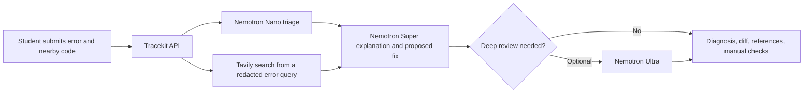

# Tracekit

**A student debugging copilot that explains an error, proposes a focused change, and leaves verification in the student's hands.**

Tracekit classifies compiler and runtime errors with Nemotron Nano, finds current references with Tavily, and asks Nemotron Super to explain the likely cause and draft a fix. Nemotron Ultra can review a difficult case when configured. The app does not execute submitted code or claim that a proposed fix passed.

**Hackathon track:** Best Apps and Agents  
**Hosted demo:** Not deployed yet  
**Screenshots:** A local preview can be opened without provider keys; screenshots and live result images are pending capture.

## How it works



Nano triage and Tavily search run in parallel. Tavily receives a short, pattern-redacted query derived from the error; it never receives the submitted code. Language-specific domains are tried first, followed by an open search if the focused search returns no sources. The filters are heuristic and cannot guarantee that every secret is removed, so inspect the query preview before sending an analysis.

Nebius Token Factory is the inference gateway for the Nano, Super, and optional Ultra stages. The code sends `store: false`. No live inference has been run from this checkout, so model access, latency, output quality, JSON-mode support, and usage fields remain unverified. Token Factory receives the full submitted error and code when a live analysis is started.

## Product safeguards

- Each model stage can make one repair request after an invalid or incomplete response, so a live analysis may use more than two model responses. Ultra review can add another model request.
- Each live analysis usually uses two model requests and one Tavily search. If the scoped Tavily search has no sources, its open-search fallback can add another search request.
- Production uses per-visitor request limits plus a shared global limit of 50 analyses per UTC day by default. `TRACEKIT_DAILY_ANALYSIS_LIMIT` changes the request count cap; it is not a dollar or token budget. Production limits require Upstash credentials.
- The UI reports retrieved sources separately from sources the model cites. Search failures and empty results are disclosed.
- The checkboxes are self-reported. Review the proposed diff, apply it yourself, then rerun the failing case and a nearby edge case locally.

## Local preview

Node.js 20.19 or later is required. The no-key preview makes no provider requests and uses no provider credits.

```powershell
npm.cmd ci
npm.cmd run dev
```

Open [http://localhost:3000](http://localhost:3000). The dev server binds to loopback. You can also double-click `START_TRACEKIT.bat` after installing dependencies. Quick-start examples only fill the input fields.

## Enable live analysis

Live analysis sends the error and code to Nebius Token Factory and a redacted query to Tavily. Requests may consume provider credits or incur charges. Check current prices, account balance, and billing controls before enabling it. This repository contains no API keys.

1. Create or select a Token Factory API key and a Tavily key through their provider dashboards. Keep keys in `.env.local`; never commit them or put them in `NEXT_PUBLIC_*` variables.
2. Copy `.env.example` to `.env.local` and set the keys, exact account-enabled model IDs, and any Upstash values needed for production.
3. Use the Token Factory model catalog to confirm model availability. Set `NEBIUS_JSON_MODE=true` only if every selected model has the JSON mode tag; the default uses prompt instructions and runtime validation.
4. Restart the development server after changing environment values.

The status card reports whether settings are present. It does not validate a key, confirm account access, or prove that an upstream call will succeed. An output repair may spend additional inference credits.

## Configuration

| Variable | Purpose |
| --- | --- |
| `NEBIUS_API_KEY` | Server-side Token Factory authentication. |
| `NEBIUS_BASE_URL` | Token Factory API base URL; defaults to `https://api.tokenfactory.nebius.com/v1`. |
| `NEMOTRON_NANO_MODEL` | Account-enabled model ID for error triage. |
| `NEMOTRON_SUPER_MODEL` | Account-enabled model ID for explanation and proposed fixes. |
| `NEMOTRON_ULTRA_MODEL` | Optional account-enabled deeper-review model. |
| `NEBIUS_JSON_MODE` | Opt-in JSON object mode; enable only for models carrying the JSON mode tag. |
| `TAVILY_API_KEY` | Tavily search authentication. |
| `TRACEKIT_DAILY_ANALYSIS_LIMIT` | Global analyses per UTC day; defaults to `50`. This counts requests, not dollars or tokens. |
| `UPSTASH_REDIS_REST_URL` | Shared production rate-limit database URL. |
| `UPSTASH_REDIS_REST_TOKEN` | Server-only shared rate-limit token and client-IP HMAC key. |

## Current status

The local prototype includes streaming stage updates, cancellation, account model discovery, request-size limits, origin checks, a bounded diff, and local/shared rate limiting. The live Token Factory and Tavily paths have not been verified. There are no measured accuracy, latency, token-cost, or fix-success results; no hosted demo, public repository, or demo video has been verified.

No screenshot is included yet. Capture one from the local no-key preview before publishing a public showcase. Do not use a screenshot containing credentials, billing details, or disconnected/error states as product evidence.

## Development

```powershell
npm.cmd run lint
npm.cmd run build
```

GitHub Actions is configured to run the same lint and build checks with read-only repository permissions. The workflow has not run on a remote repository. These checks do not validate live providers, shared production limits, deployment, or submission status.

See [the documentation index](docs/README.md), [the implementation log](docs/internal/BUILD_LOG.md), [the review handoff](docs/internal/REVIEW_GUIDE.md), [the deployment runbook](docs/DEPLOYMENT.md), and [the submission draft](docs/submission/DRAFT.md). Repository review instructions are in [CLAUDE.md](CLAUDE.md).

## License

MIT. See [LICENSE](LICENSE).
